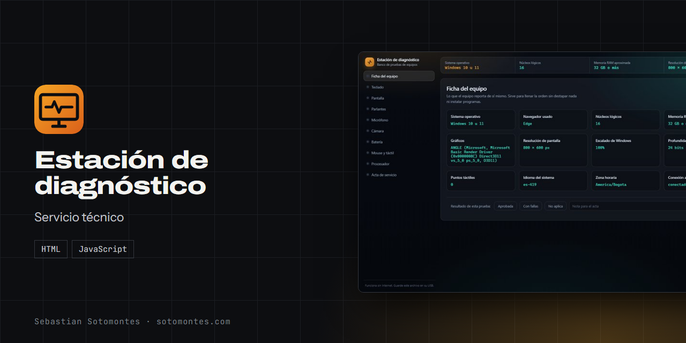
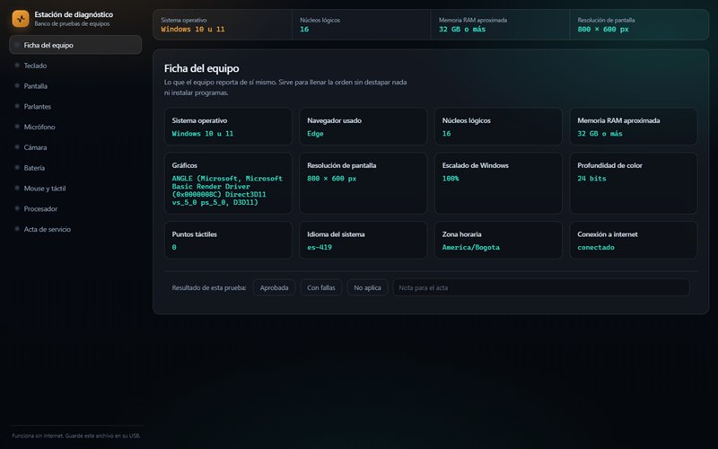
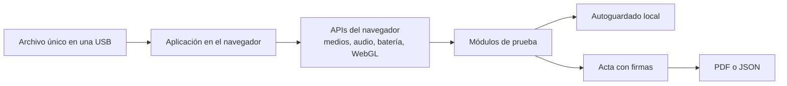

Banco de pruebas de hardware que corre desde una USB, sin internet, y genera un acta de servicio firmada.

<a href="https://sotomontes.com/#estacion-de-diagnostico"><b>Ver en sotomontes.com</b></a> · <a href="#cómo-se-usa">Cómo se usa</a> · <a href="#cómo-funciona-por-dentro">Cómo funciona</a> · <a href="#novedades">Novedades</a>

| Ficha técnica | |
|---|---|
| **Autor** | Sebastian Sotomontes |
| **Tipo** | Servicio técnico |
| **Plataforma** | Navegador, desde una USB |
| **Versión** | 1.0 |
| **Estado** | Estable |
| **Stack** | HTML · JavaScript |
| **Código** | Privado. Esta página es solo una presentación. |

---

## Qué es

La Estación de diagnóstico es un banco de pruebas de hardware que corre desde una USB en cualquier PC, sin internet y sin instalar nada. Está pensada para servicio técnico: revisa el equipo al recibirlo y termina generando un acta firmada que protege al técnico y al cliente.

## Novedades

- Acta de servicio con firma y resultados autollenados.

## Cómo se usa

1. Copia el archivo a la raíz de una USB.
2. En el equipo que recibes, ábrelo con doble clic en Chrome o Edge y permite cámara y micrófono.
3. Recorre las pruebas del menú y marca cada una como aprobada, con fallas o no aplica.
4. Abre **Acta de servicio**: la tabla de resultados ya viene llena.
5. Firma en pantalla junto al cliente.
6. Exporta el acta a PDF o a JSON.

## Funciones

- **Ficha del equipo**: sistema, procesador, memoria, gráficos y pantalla.
- **Teclado** latino completo con detección tecla por tecla.
- **Pantalla** con colores, degradados, cuadrícula y patrón para píxeles pegados.
- **Parlantes, micrófono y cámara** con pruebas en vivo.
- **Batería, mouse y táctil** con lienzo de dibujo y multitáctil.
- **Estrés de CPU** con detección de throttling térmico.
- **Acta de servicio** con firma de ambas partes.

## Detalles

- El estado se guarda solo, por si se cierra por accidente.
- La tecla Windows no se puede probar: el sistema la captura antes que el navegador.
- El navegador reporta la memoria RAM redondeada.

## Cómo funciona por dentro

### Arquitectura

### Cómo funciona

Cada módulo usa una API del navegador: Web Audio para los tonos por canal y el barrido de 100 Hz a 12 kHz, los dispositivos multimedia para cámara y micrófono, y WebGL para identificar los gráficos. La prueba de CPU mantiene carga durante 15 o 60 segundos y grafica cada ciclo: si el rendimiento cae con el tiempo, delata throttling térmico. Los resultados alimentan el acta sin volver a escribirlos.

---

© 2026 Sebastian Sotomontes. Todos los derechos reservados.
